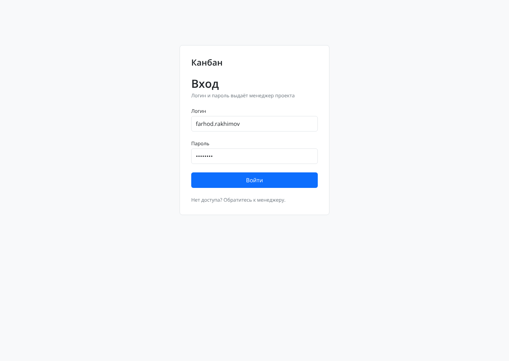
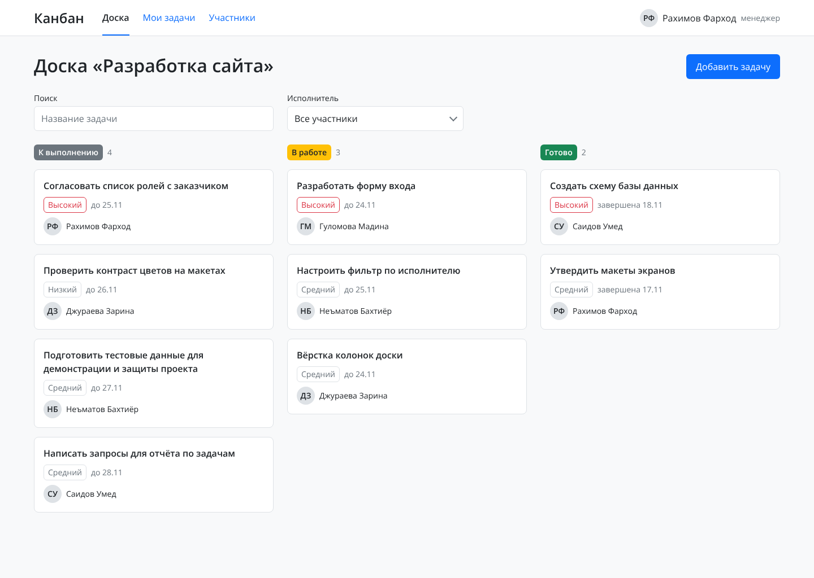
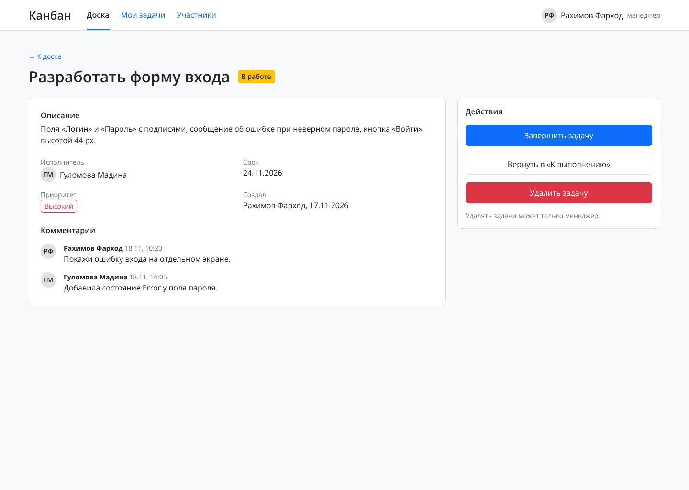
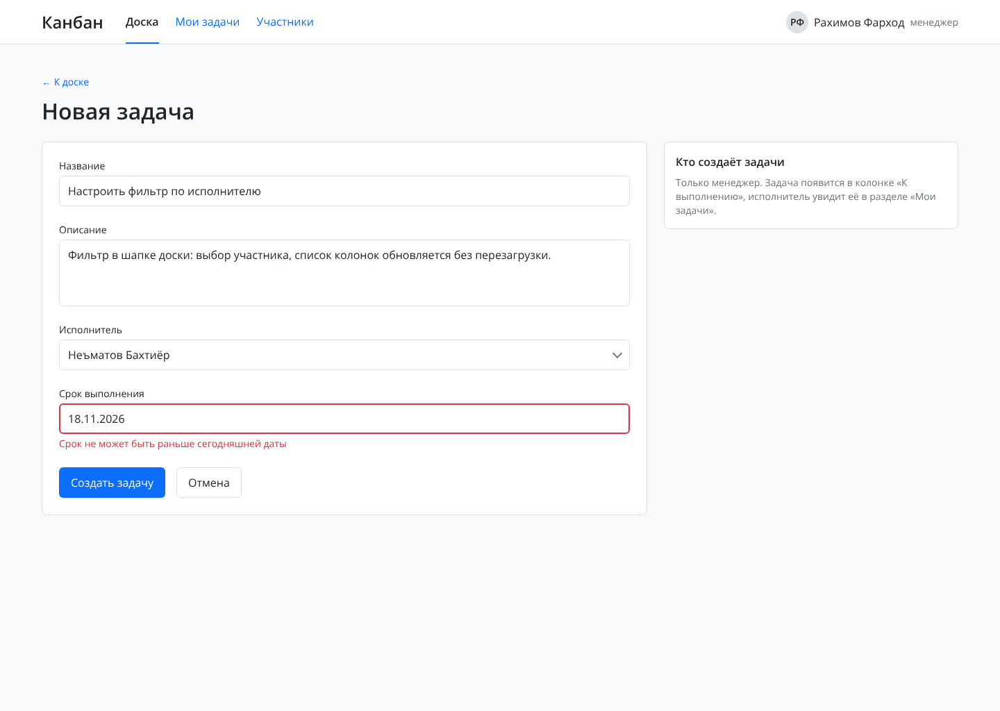
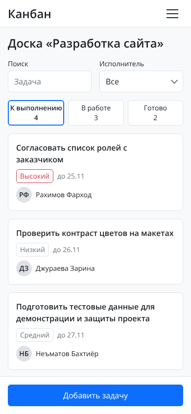

# UI-kit: Канбан

Figma: <ссылка на файл> · прототип: <ссылка Present>

## Пользовательские сценарии

Имена экранов совпадают с маршрутами будущего приложения.

1. Менеджер создаёт задачу: `/login` → `/` (доска) → `/tasks/create` → [Создать задачу] → `/` (сообщение «Задача создана»).
2. Участник завершает задачу: `/login` → `/` → `/tasks/{id}` → [Завершить задачу] → `/` (задача в колонке «Готово»).

## Сетка

Desktop 1440: 12 колонок × 88 px, gutter 24 px, контент 1320 px (`.container`).
Mobile 390: 4 колонки, margin 16, gutter 16.
Шаг отступов: 4 / 8 / 16 / 24 / 32 px.

| Экран | Раскладка на сетке | Bootstrap |
|---|---|---|
| `/` (доска) | фильтры 4 + 3 колонки; три колонки задач по 4 | `.col-4`, `.col-3`, `.col-4` × 3 |
| `/tasks/{id}` | содержимое 8 + панель действий 4 | `.col-8` + `.col-4` |
| `/tasks/create` | форма 8 + подсказка 4 | `.col-8` + `.col-4` |
| `/login` | карточка 4 колонки по центру | `.col-4 .offset-4` |
| `/` на мобильном | одна колонка, вкладки статусов | `.nav-pills`, `.col-12` |

## Брендовый цвет

Используется синий Bootstrap `#0D6EFD`. Переменные (`--bs-primary` и др.) в день 10 не переопределяются.

## Цвета

| Стиль | HEX | Bootstrap | Где используется |
|---|---|---|---|
| color/primary | #0D6EFD | --bs-primary | основные кнопки, ссылки, активная вкладка |
| color/success | #198754 | --bs-success | статус «Готово» |
| color/warning | #FFC107 | --bs-warning | статус «В работе» (текст тёмный) |
| color/danger | #DC3545 | --bs-danger | ошибки, «Удалить задачу», высокий приоритет |
| color/text | #212529 | --bs-body-color | основной текст |
| color/muted | #6C757D | --bs-secondary | подписи, статус «К выполнению» |
| color/border | #DEE2E6 | --bs-border-color | рамки |
| color/bg | #F8F9FA | --bs-light | фон страницы |

## Типографика

Noto Sans (полная кириллица); h1 32/40 SemiBold, h2 24/32 SemiBold, body 16/24 Regular, small 14/20 Regular.

## Компоненты

- Button: Primary / Secondary / Danger × Default / Hover / Disabled, высота 44 px → `.btn .btn-primary`, `.btn-outline-secondary`, `.btn-danger`
- Input: Default / Focus / Error / Disabled, подпись над полем, высота 44 px → `.form-label`, `.form-control`, `.is-invalid`, `.invalid-feedback`
- TaskCard (карточка задачи: название, приоритет, срок, исполнитель) на Auto Layout → `.card` + `.card-body` + `.d-flex`
- StatusBadge: «К выполнению» (muted, белый текст), «В работе» (warning, тёмный текст), «Готово» (success, белый текст) → `.badge`

## Доступность

| Пара | Контраст | Норма 4.5:1 |
|---|---|---|
| белый текст на color/primary | 4.50 | на границе, проходит |
| color/muted на белом | 4.69 | проходит |
| белый текст на color/success | 4.53 | проходит |
| белый текст на color/danger | 4.53 | проходит |
| белый текст на color/warning | 1.63 | не проходит |
| color/text на color/warning | 9.46 | проходит |

Поэтому на жёлтом бейдже «В работе» текст тёмный (color/text). Значения рассчитаны по формуле WCAG 2.1; в Figma проверены плагином <название плагина>.

Остальные правила: основной шрифт 16 px; кнопки, поля и ссылки-действия не ниже 44 px; у всех полей есть подпись; статус задачи записан словом, а не только цветом.

## Экраны

